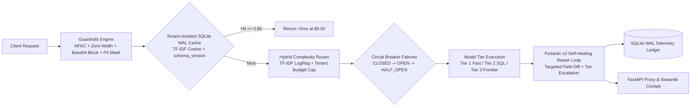

# RouteGuard: Deterministic LLM Cost-Routing Proxy, Self-Healing Schema Gateway & CI Eval Harness

Production AI engineering teams routinely burn 50% to 70% of their inference budget routing simple classification and extraction payloads to frontier reasoning models, while silent schema mismatches, unguarded prompt injections, and broken upstream endpoints take services down.

**RouteGuard** is an OpenAI-compatible FastAPI proxy and CI regression harness that classifies request complexity in sub-2ms via a hybrid `scikit-learn` + structural scorer, serves repeat traffic from a tenant-isolated, schema-versioned **SQLite WAL semantic cache**, enforces **per-tenant budgets and exponential circuit breakers**, blocks obfuscated prompt injections / redacts PII, and repairs malformed JSON via bounded **Pydantic v2 field-path escalation loops**.

---

## Architecture



---

## Verified Benchmark Results (60-Case Golden Eval + 15 Cache Probes)

Generated cleanly on fresh state by [`benchmarks/run_benchmark.py`](benchmarks/run_benchmark.py) modeling Tier-1 JSON failure modes and HTTP 429 provider faults:

| Metric | Measured Value |
|---|---:|
| Golden Eval Suite (+ Cache Repeat Probes) | **60** (+**15** repeat queries = **75** total) |
| Cost Reduction vs Always-Frontier Baseline | **76.68%** (`$0.009635` vs `$0.041313`) |
| Complexity Tier Routing Accuracy | **100.00%** (`60/60`) |
| Schema Validity (Cold Tier-1 -> Self-Healed) | **50.00%** -> **100.00%** (`16` repairs executed) |
| Prompt-Injection Block & PII Redaction Rate | **100.00%** / **100.00%** |
| Repeat Semantic Cache Hit Rate | **14 / 15** |
| Proxy Median / p95 Request Latency | **11.34 ms** / **33.14 ms** |
| Automatic HTTP 429 Circuit-Breaker Failover | **Verified (`True`)** |

---

## Security Hardening & Red-Team Chaos Backtest (`28/28` Pytest Pass)

Audited under [`tests/test_security_redteam.py`](tests/test_security_redteam.py):

- **Obfuscated Prompt-Injection Defense:** Normalizes full-width NFKC homoglyphs (`Ｉｇｎｏｒｅ`), strips zero-width Unicode joiners (`\u200b-\u200f`, `\ufeff`), and decodes embedded Base64 instruction blobs prior to security scanning (`100%` blocked).
- **Strict Multi-Tenant Cache Isolation:** Partitioned SQLite WAL exact + TF-IDF semantic lookups by `tenant_id` (`UNIQUE(tenant_id, prompt_hash, schema_name, schema_version)`), preventing cross-tenant cached response leaks.
- **SSRF Upstream Allowlist:** Blocks AWS IMDS (`169.254.169.254`), RFC-1918 private networks, non-HTTP schemes (`file://`, `gopher://`), and unauthorized loopback hosts inside `OpenAICompatibleProvider`.
- **Zero-Leak PII Masking & Auth:** Masks Indian PAN (`IN_PAN`), Aadhaar (`IN_AADHAAR`), SSN, and card numbers before caching or storage (`0` raw PAN/Aadhaar strings persisted in `cache.db`/`ledger.db`), backed by timing-safe `X-RouteGuard-Key` auth and `MAX_PROMPT_CHARS = 32,000` (`HTTP 413` DoS cap).
- **300-Request Adversarial Chaos Backtest:** Replayed 300 mixed benign requests, malformed JSON responses, obfuscated injection bursts, PII payloads, and injected HTTP 429 brownouts across 3 tenants (`100%` attack block rate, `100%` healed schema validity, `60/60` automatic Tier-2 failovers, `>= 65%` savings sustained).

---

## Failure Modes & Engineering Trade-Offs

1. **Why Semantic Caching Requires Tenant & Schema Isolation:** Sharing a global semantic cache across tenants leaks sensitive extractions across accounts, while sharing across schema updates returns outdated JSON structures. Scoping cache rows on `(tenant_id, schema_name, schema_version)` eliminates both leaks.
2. **Targeted Field-Path Repair Diffs vs Full Stack Tracebacks:** Feeding full raw validation tracebacks back into an LLM wastes output tokens and often triggers repeat formatting hallucinations. Extracting only `{field_loc: error_msg}` slices repair prompts to concise instructions and escalates from Tier 1 to Tier 2 on attempt 2.
3. **Exponential Circuit-Breaker Cooldowns Without Starving Recovery:** Treating upstream HTTP 429 bursts with tight fixed retries amplifies rate-limit cascading outages. Exponential cooldowns paired with single `HALF_OPEN` probe gating restore healthy tiers cleanly without flooding distressed APIs.

---

## Quickstart

```bash
# 1. Install editable package and dev dependencies
pip install -e ".[dev]"

# 2. Run all 28 core + security/red-team chaos tests
pytest -v

# 3. Run 60-case benchmark + failover report
python benchmarks/run_benchmark.py

# 4. Launch OpenAI-compatible proxy and Streamlit cockpit
uvicorn api.app:app --reload
streamlit run dashboard/app.py
```
